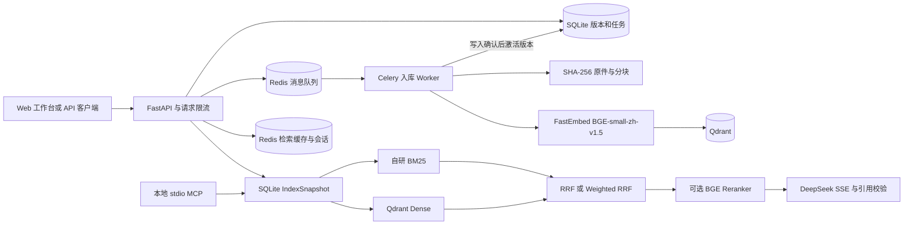

# QueryForge

QueryForge 是面向企业知识库检索与问答的单机异步 RAG 后端。它提供 PDF/TXT 异步入库、可切换的混合检索、版本化缓存、带引用的问答，以及用于观察这些链路的 Web 工作台。

| 入口 | 地址 |
|---|---|
| 本地工作台 | http://127.0.0.1:8000/ |
| 本地 OpenAPI | http://127.0.0.1:8000/docs |
| 就绪与实时依赖 | http://127.0.0.1:8000/api/v1/ready |
| 部署与回滚 | [部署说明](docs/DEPLOYMENT.md) |
| 测试与工程验收 | [工程审计](docs/ENGINEERING_AUDIT.md) |
| 最终交付状态 | [交付报告](docs/FINAL_DELIVERY.md) |
| ModelScope 创空间部署 | [魔搭部署说明](docs/MODELSCOPE.md) |

## 架构与技术栈



- 目标运行环境为 Python 3.11。HTTP 使用 FastAPI 与 Uvicorn，元数据使用 SQLAlchemy 和 SQLite WAL。
- Celery 消费 Redis 消息，FastEmbed 执行 BGE 嵌入与 Cross-Encoder 推理，Qdrant 保存按版本过滤的向量。
- LangChain 接入 DeepSeek。SSE 实时发送草稿，响应完成后校验引用。
- Docker Compose 编排本机服务，Pytest、GitHub Actions 与 Locust 分别覆盖自动化回归、CI 配置及 HTTP 负载。

## 本地运行

复制 .env.example 为 .env。Windows 可使用 PowerShell。新建配置时先保留空的模型密钥即可验证入库与搜索。

```powershell
Copy-Item .env.example .env
docker compose build api
docker compose up -d --no-build --wait
docker compose ps
```

已有 .env 时保留其自定义配置。默认限流为普通 API 600 次/分钟、Chat 12 次/分钟、并发 24。所有发布端口默认绑定宿主机回环地址。首次入库或排序会加载模型，模型缓存位于 Compose 持久化卷。HF_ENDPOINT 可指定经审查的镜像源。

打开工作台，上传 examples/demo 中的 TXT，待状态为 completed 后检索 Redis AOF。更新版本时传入同一文档 ID。每次成功激活后，旧版本从新请求的快照中移除。RAG、流式生成和 Function Calling 需要有效的服务端 DeepSeek 密钥。

## API 与数据链路

| 方法与路径 | 用途 |
|---|---|
| GET /api/v1/health、/api/v1/ready | 进程存活、SQLite/Redis/Qdrant 就绪 |
| GET /api/v1/system/status、/api/v1/system/experiments | 实时状态、实验归档 |
| POST /api/v1/documents/upload | multipart 的 file 与可选 document_id |
| GET /api/v1/documents、/api/v1/documents/tasks/{task_id} | 分页查版本、查任务进度 |
| POST /api/v1/search | query、mode、top_k、rerank |
| POST /api/v1/chat/completions | 常规或 SSE 问答，可传 session_id |
| POST /api/v1/chat/tool-completions | 本地 Function Calling 及证据记录 |

```bash
curl -F 'file=@examples/demo/redis-aof.txt' http://127.0.0.1:8000/api/v1/documents/upload
curl -H 'Content-Type: application/json' \
  -d '{"query":"Redis AOF","mode":"adaptive","top_k":5,"rerank":false}' \
  http://127.0.0.1:8000/api/v1/search
curl -N -H 'Content-Type: application/json' \
  -d '{"query":"Redis AOF 如何恢复数据？","stream":true}' \
  http://127.0.0.1:8000/api/v1/chat/completions
```

1. **入库**。上传校验大小、类型及 UTF-8/PDF 文件头，以 SHA-256 存储原件。SQLite 先记录任务与版本，Celery 再分阶段解析、切片、编码和分批写入 Qdrant。向量写入全部确认后，单个 SQLite 事务完成版本切换和 revision 自增。
2. **检索**。同一 SQLite 快照固定 revision 与可见版本。BM25 和 Dense 有界并行，Hybrid 使用等权 RRF，Adaptive 由路由器按问题类型调整权重。响应带实际策略、分数类型、融合权重、缓存状态、降级及延迟。
3. **问答**。LLM 接收有界的检索证据和历史上下文。SSE 的 delta 是草稿，界面以 final 替换，error 或连接终止时清除草稿。TTFT 分别记录从请求开始及模型调用开始到首个 delta 的耗时。Token 字段以提供方返回为准。多轮历史保留最近三轮并设置 TTL。
4. **工具**。Function Calling 最多执行三轮工具处理与四次工具调用，参数由 Pydantic 校验，只允许检索和读取文档元数据。响应带工具、状态、耗时和证据编号。MCP 独立通过 stdio 接入，同样提供这两个只读工具。

```bash
docker compose exec -T api python -m app.mcp_server
python scripts/mcp_smoke.py
docker compose exec -T api python -m app.recovery --min-age 900 --limit 20
```

MCP Smoke Test 需要有已生效的演示文档。任务补偿默认由 CLI 或宿主机受控定时任务触发。任务使用 late ACK、可恢复阶段、文件互斥、指数退避和持久化尝试上限。缓存键包含 revision、可见版本和检索参数。Redis 缓存故障时重走检索，公网会话归属服务失效时拒绝问答请求。

## 自动化测试与实验

```bash
python3.11 -m venv .venv311
source .venv311/bin/activate
python -m pip install -r requirements-dev.txt
python -m pip check
python -m compileall -q app tests scripts
python -m pytest -q --cov=app --cov-report=term-missing
```

Linux Python 3.11 的同环境对照为 108 项、69.05% 到 123 项、83.94%。Windows 使用本机 Python 3.11 的完整解释器路径创建虚拟环境，然后执行 .venv311\Scripts\python.exe。测试包含纯单元用例，以及使用临时 SQLite、Qdrant 本地适配器和真实 ASGI 路由的集成用例。实际 Docker 端到端测试使用独立项目与模拟文档，避免改变原有知识库。

使用单独 Compose 项目运行端到端和负载测试。建立 .env.smoke，写入空 LLM_API_KEY 以及 RUN_MODE=local，再从已构建的本机镜像启动。

```bash
QUERYFORGE_ENV_FILE=.env.smoke API_BIND_PORT=18000 REDIS_BIND_PORT=16379 QDRANT_BIND_PORT=16333 \
  docker compose -p queryforge-smoke up -d --no-build --wait
```

```bash
python scripts/integration_smoke.py --base-url http://127.0.0.1:18000/api/v1
python -m pip install -r requirements-benchmark.txt
python scripts/prepare_benchmark.py --output data/benchmark/dataset.json
QDRANT_URL=http://127.0.0.1:16333 python -m app.benchmark --dataset data/benchmark/dataset.json --output data/benchmark/new-run.json
python -m pip install -r requirements-load.txt
LOAD_REPORT=data/loadtest/new-run.json python -m locust -f scripts/locustfile.py \
  --headless -u 100 -r 10 -t 45s --stop-timeout 5 --host http://127.0.0.1:18000
```

Benchmark 建立独立临时 Qdrant collection，结束时回收该 collection。准备脚本以已存的 T2Retrieval 修订版和种子重建样本，输出文件必须是新路径。新协议用独立开发查询预热每种策略，且参考 BM25 仅输出至少命中一个词的候选。实验覆盖的是 500 篇文档的抽样语料，相关性标签被用于纳入正例。未用测试集调参，但这批历史查询已被观察。数据来源见 [T2Retrieval](https://huggingface.co/datasets/mteb/T2Retrieval/tree/main)。

| 历史策略 | Recall@10 | MRR@10 | NDCG@10 | P95 ms |
|---|---:|---:|---:|---:|
| BM25 Reference | 0.8314 | 0.9067 | 0.8434 | 2.595 |
| BM25 | 0.8314 | 0.8900 | 0.8306 | 1.349 |
| Dense | 0.9608 | 1.0000 | 0.9776 | 16.569 |
| Hybrid | 0.9431 | 0.9611 | 0.9334 | 16.642 |
| Adaptive | 0.9431 | 0.9611 | 0.9343 | 16.646 |
| Adaptive + Reranker | 0.9655 | 1.0000 | 0.9775 | 15959.58 |

Dense 在该小样本里比 Hybrid 和 Adaptive 同时拥有更高的指标与略低的 P95。Reranker 当时的 Recall@10 提升约 0.47 个百分点，P95 约 16 秒。独立暖机复测中，Dense P95 为 15.288 ms，Reranker 为 17,452.847 ms。逐查询结果见 [暖机复测](docs/benchmark_audit_warmed.json)。原始 100 用户实验为 4,902 请求、4,883 成功、99.61% 成功率、110.03 成功 QPS、19 次 503 与零次检索降级，热点 P95 82.937 ms，冷查询 P95 115.381 ms。后续保护配置和负载条件见 [原实验](docs/loadtest/users_100.json)、[原限流实验](docs/loadtest/protected_100.json) 和 [工程审计](docs/ENGINEERING_AUDIT.md)。

## 演示知识库

`examples/demo/kb` 收录 19 篇公开技术说明（缓存一致性、缓存故障模式、Celery 投递与重试、幂等、Qdrant、HNSW、余弦相似度、FastAPI 并发、SSE、BM25、Dense、RRF、Adaptive、Reranker、RAG、Function Calling、MCP、限流降级），每篇附公开来源。语料由 `scripts/seed_demo_corpus.py` 通过真实上传接口入库，重复执行按内容哈希去重。

```bash
DEMO_ADMIN_TOKEN=*** DEMO_API=http://127.0.0.1:18001 python scripts/seed_demo_corpus.py
```

脚本输出 20 个版本 ID，审核后写入演示环境的 `DEMO_PUBLIC_VERSION_IDS`，再重建演示 API。演示语料与 500 篇 Benchmark 语料严格分离。

## 公网演示与局限

公网演示使用独立 Compose 项目和数据卷。访客可以读取明确批准的活跃版本。管理接口使用独立 Bearer token，浏览器会话使用 HttpOnly Cookie 与 Redis 归属校验。付费问答默认关闭，启用后按 SQLite 记录部署生命周期的调用额度。管理与付费配置、HTTPS、备份和回滚参见 [部署说明](docs/DEPLOYMENT.md)。

SQLite WAL 和文件互斥预期运行在同机磁盘上。容量与热缓存、模型加载、文本长度及 CPU 有关。引用格式校验保证引用指向该轮检索中的有效编号，回答事实正确性仍需由人核对。Redis、Qdrant、模型 CPU 和单节点数据卷均需独立运维。
